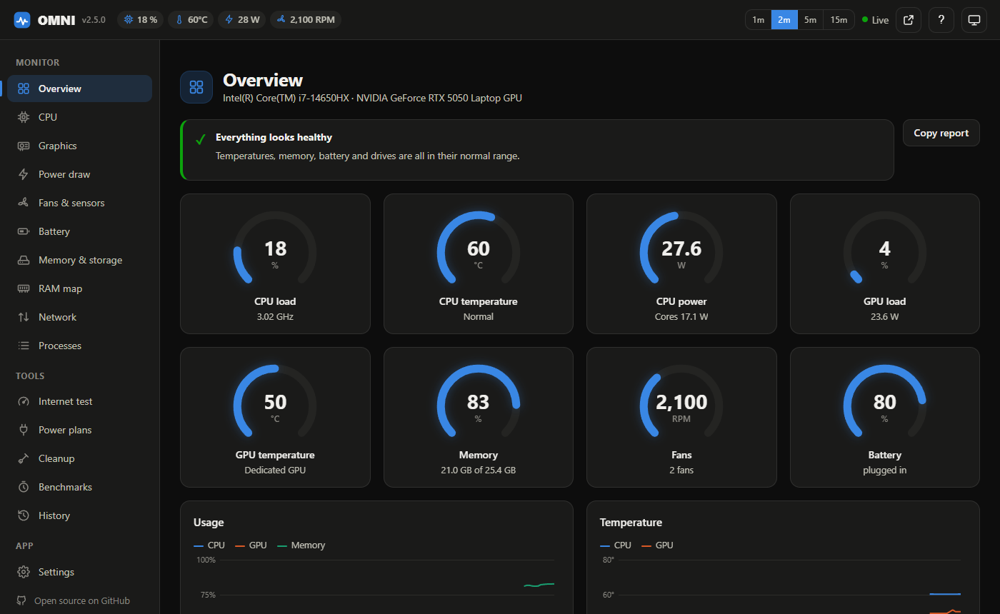
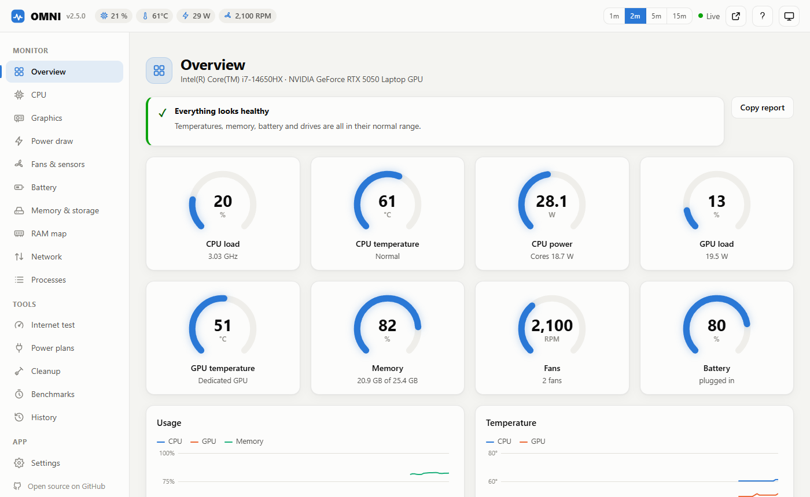

# OMNI

A laptop telemetry and tuning tool for Windows: live hardware dashboard, battery health,
real benchmarks, stress tests with throttling detection, safe cleanup and reversible
power tweaks. A ground-up rewrite of [ubat](https://github.com/Scrooge-777/ubat) (OMNI 1.x).

- **Works on any Windows laptop:** Dell, HP, Lenovo, ASUS, Acer, MSI, Microsoft Surface and more.
  Core readings (CPU, memory, battery health, SSD health, network) come from Windows itself.
  Fan speeds and fan modes depend on the maker; `omni device` shows what your model supports.
- **One engine, three interfaces:** web dashboard, terminal dashboard and command line all
  use the same sensor collector.
- **Metric everywhere:** °C, W, Wh, GB and MB/s by default. Fahrenheit, binary sizes (GiB)
  and mWh are options in Settings.
- **No made-up numbers:** values come from the hardware. When a sensor isn't available
  the UI says so instead of showing a placeholder value.

<p align="center">
  
  
</p>

## What is it good for?

- **Buying or selling a used laptop:** `omni report` gives battery health (health %, wear, cycles), SSD health and a plain verdict you can paste into a listing or send to a buyer.
- **"Why is my laptop slow, hot or loud?":** live temperatures, clocks, watts per component, fan speed and a throttling check (stress test) show whether it is heat, power limits or just a busy process.
- **Battery life:** see what is drawing power, and apply reversible battery-only tweaks.
- **Peace of mind:** a mini window or the terminal dashboard keeps the essentials visible, and alerts warn about heat, low battery and failing drives.

## Quick start

**Easiest: no Python needed.** Download `OMNI.exe` from the
[latest release](https://github.com/Scrooge-777/omni/releases/latest) and double-click it. The dashboard opens in your browser.
Windows may show a "protected your PC" (SmartScreen) notice because the file is not code-signed yet:
choose *More info*, then *Run anyway*. Compare the file with the published `OMNI.exe.sha256` first if you like
(`certutil -hashfile OMNI.exe SHA256`).

**From source** (Windows 10/11, Python 3.11+):

```powershell
git clone https://github.com/Scrooge-777/omni
cd omni
pip install -e .
omni            # opens the web dashboard at http://localhost:5050
```

Or double-click `OMNI.bat` in the source folder.

| Command | What it does |
|---|---|
| `omni` / `omni web` | Web dashboard (`--port`, `--no-browser`) |
| `omni tui` | Terminal dashboard (`q` quit, `s` sort processes) |
| `omni status [--json]` | One-shot summary |
| `omni battery` | Battery health report |
| `omni report [-o file.md]` | One-page health report (battery, drives, readings) safe to share |
| `omni device [--json]` | Identify this PC and list what OMNI can read and change on it |
| `omni bench cpu\|memory\|disk\|gpu\|all` | Benchmarks (saved to history) |
| `omni stress cpu\|gpu\|both --seconds 120` | Stress test with throttling report |
| `omni power list` | Plans, Windows power mode, battery tweaks |
| `omni power plan "Balanced"` · `omni power mode efficiency` | Switch plan / power mode |
| `omni power tweak boost_on_battery 0` · `omni power restore` | Change / undo a battery tweak |
| `omni clean` · `omni clean --run user_temp crash_dumps` | Scan / delete junk files |
| `omni speedtest [--diagnostics]` | Internet speed, latency, bufferbloat (+ ping & DNS comparison) |
| `omni ram` · `omni ram --empty standby_low` | RAM map and RAMMap-style Empty commands (admin) |
| `omni history export --range 7d -o week.csv` | Export recorded telemetry |
| `omni settings get` · `omni settings set units.temperature F` | View / change settings |

## Keyboard and mini window

| Key | Action |
|---|---|
| `1`–`0` | Jump to a section (sidebar order) |
| `[` `]` | Previous / next section |
| `T` | Change theme (system, dark, light) |
| `M` | Open the mini window (verdict and gauges only) |
| `?` | Show the shortcut list |

Gauges and the health verdict use symbols and words as well as color, and respect your system's
reduced-motion and dark/light settings.

## What it reads

| Area | Source | Notes |
|---|---|---|
| CPU load, live clock, temperature | psutil + Windows PDH counters (in-process) | Live clock = base × "% Processor Performance", as in Task Manager |
| GPU | NVIDIA NVML (`nvml.dll`) | Load, temp, power vs limit, clocks, VRAM, P-state, and **why** clocks are limited |
| Battery | psutil, `root/wmi` battery classes, `powercfg /batteryreport` | Real design capacity, health %, wear, cycles, charge/discharge W, voltage |
| SSD | Storage reliability counters | Health, temperature, wear |
| Memory, disk I/O, network, processes | psutil | Process CPU % uses Task Manager's scale |
| Watts per component | Windows Energy Meter (RAPL) + NVML + battery discharge | CPU package/cores/iGPU, dGPU, whole laptop on battery |
| Every GPU | DXGI + Windows GPU counters | Intel, AMD, NVIDIA; per-engine load and memory |
| Fans | HP WMI BIOS · Dell Command \| Monitor · HP business BIOS · Lenovo Gaming Zone · Win32_Fan · LibreHardwareMonitor · HWiNFO | RPM on most PCs; Max-fan switch on HP OMEN/Victus |
| RAM map | `NtQuerySystemInformation` memory lists + counters | Standby by priority, modified, free, zeroed |

## Dashboard sections

**Monitor:** Overview (8 live gauges) · CPU (3D cylinder per thread) · Graphics · Power draw ·
Fans & sensors · Battery · Memory & storage · RAM map · Network · Processes.
**Tools:** Internet test · Power plans · Cleanup · Benchmarks (+ stress test) · History.
**App:** Settings. Light and dark themes, animations (can be turned off), works at phone width.

**Any PC:** `omni device` and the Fans & sensors page identify the machine (maker, model, line, BIOS) and shows what OMNI can read and change on it, and which maker app handles the rest.

**Fans on other PCs:** Windows has no standard fan API. Start LibreHardwareMonitor (as administrator)
or HWiNFO with *Shared Memory Support* on, and OMNI shows every fan and sensor they can read.

## Settings

Stored in `%APPDATA%\OMNI\settings.json` (validated; a bad value falls back to its default).

| Group | Settings |
|---|---|
| General | refresh interval, theme, dashboard port, open browser on start |
| Units | temperature °C/°F, data sizes metric (GB) or binary (GiB), battery Wh/mWh |
| GPU | read the GPU, poll GPU on battery (off by default so Optimus can power the GPU down) |
| History | record on/off, sample interval, retention days |
| Alerts | low battery %, charge reminder %, CPU/GPU/SSD temperature limits |
| Battery | design capacity override |
| Cleanup | minimum file age |
| Processes | protected process names |

History, the battery-report cache and power-setting backups live in the same folder.

## Safety

- **Web server:** listens on `127.0.0.1` only. Every API call needs a per-run secret token,
  and requests with a foreign `Host` header are refused (blocks other websites and DNS
  rebinding from driving the dashboard). The live WebSocket checks the browser `Origin` too.
  Strict Content-Security-Policy. See [SECURITY.md](SECURITY.md).
- **Power tweaks** only change on-battery values, save the originals first, and
  `Restore` puts them back. **PCIe ASPM is never touched**: on some NVMe drives it makes
  the SSD drop off the bus (WHEA Event 17).
- **Cleanup** is scan-first, deletes only files older than the age setting, never follows
  links or junctions, skips files in use, and reports only what was actually deleted.
- **Process ending** refuses Windows-critical processes, OMNI itself and anything on the
  protected list.

## Development

```powershell
pip install -e ".[dev]"
pytest
```

See [CONTRIBUTING.md](CONTRIBUTING.md). To add support for your laptop model, open the
**My laptop is not fully supported** issue and paste the output of `omni device`.
Releases build `OMNI.exe` with PyInstaller (`packaging/launcher.py`) when a `v*` tag is pushed.

Layout:

```
src/omni/
  sensors/      cpu, gpu (NVML), battery, system (memory/storage/network), processes
  win/          PowerShell + PDH counter helpers
  collector.py  polling loop, live buffer, history writes, alerts
  history.py    SQLite store       alerts.py   thresholds with hysteresis
  bench.py      benchmarks + stress tests       power.py    plans, mode, tweaks
  cleanup.py    scan/clean          config.py   settings      units.py   metric formatting
  web/          FastAPI app + static UI (no external CDN, works offline)
  tui.py        rich terminal dashboard         cli.py      command line
```

See [CHANGELOG.md](CHANGELOG.md) for everything that changed from ubat 1.x and
[docs/research.md](docs/research.md) for the research behind the design.

## Licence

MIT, see [LICENSE](LICENSE).
